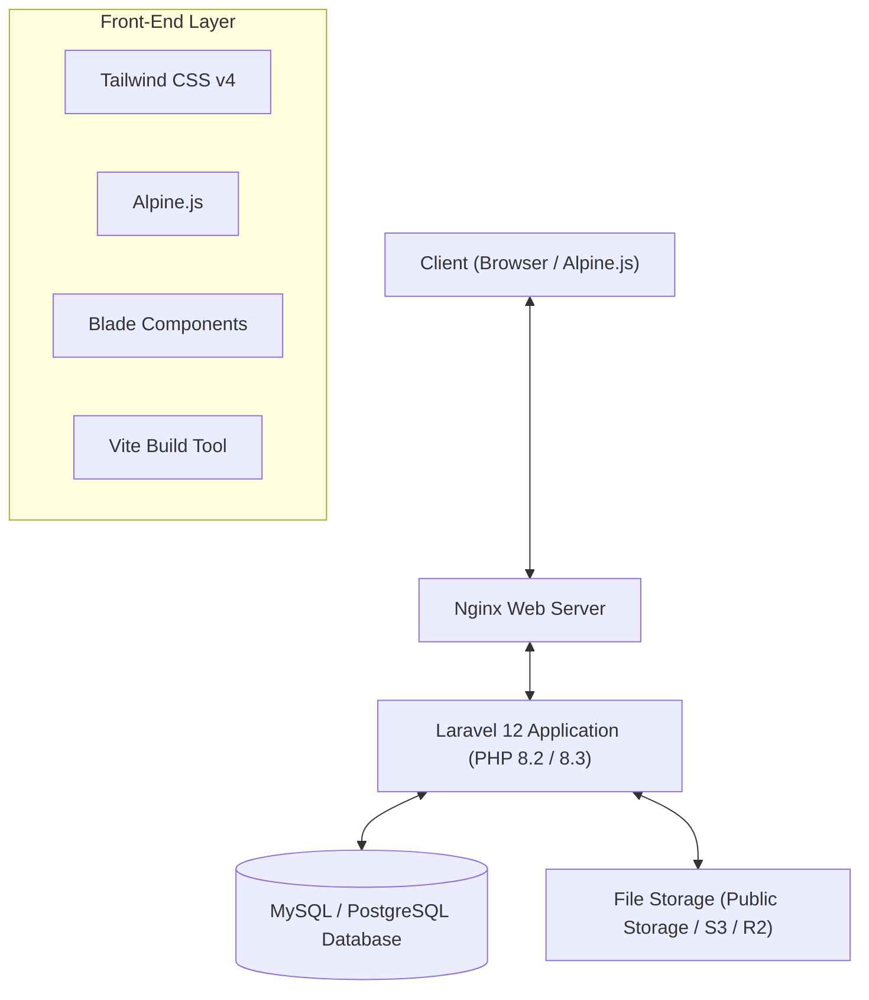

# Variety — Modern E-Commerce Platform

<p align="center">
  
</p>

<p align="center">
  <a href="https://laravel.com"></a>
  <a href="https://php.net"></a>
  <a href="https://tailwindcss.com"></a>
  <a href="https://alpinejs.dev"></a>
  <a href="https://vitejs.dev"></a>
  <a href="https://railway.com"></a>
</p>

---

## 📖 Overview

**Variety** is a modern, high-performance, full-stack e-commerce web platform engineered with **Laravel 12**, **Tailwind CSS v4**, and **Alpine.js**. Designed with user experience, conversion, and operational control in mind, Variety delivers a complete online shopping workflow—from dynamic multi-attribute product variations to automated checkout, customer reviews with media uploads, store chat, and an administrative back-office.

---

## ✨ Key Features

### 🛍️ Customer Experience & Storefront
* **Dynamic Multi-Level Catalog:** Browse products seamlessly through structured Menu Tabs, Categories, Sub-Categories, and Sub-Sub-Categories.
* **Smart Product Variations:** Real-time color swatches, size pickers, and dynamic pricing/stock updates based on the selected variant combinations.
* **Customer Reviews & Photo Uploads:** Verified buyer reviews featuring star ratings, media attachments, and interactive filter controls (All, With Photos/Videos, Star Ratings).
* **Interactive Store Profiles:** Store stats including chat response rate, response time, store rating, follower counters, and seller avatars.
* **Wishlist & Favorites:** One-click instant favorite toggle with immediate state persistence.
* **Customer-Seller Live Chat:** Built-in messaging channels allowing direct communication regarding product specifications and orders.

### 🛒 Checkout & Order Flow
* **Variant-Aware Shopping Cart:** Add specific color and size variations with accurate quantity tracking, variant thumbnails, and subtotal calculations.
* **Streamlined Checkout:** Fast checkout supporting saved user delivery addresses, phone validation, and multiple payment methods (Bank Transfer / Virtual Account, Cash on Delivery / COD).
* **Order History & Invoicing:** Automatic unique invoice generation (`INV-XXXXXXXXXX`) and real-time stock deduction with order status tracking.

### 🛠️ Admin & Seller Management Panel
* **Role-Based Access Control (RBAC):** Strict permissions separating `admin`, `seller`, and `user` roles.
* **Visual Variant Manager:** Configure single or multi-dimensional variations (Color swatches, Sizes, Custom SKU names, prices, and variant-specific imagery) directly through the admin GUI.
* **Order & Fulfillment Management:** Track customer orders, inspect buyer items, and update delivery statuses.
* **Category Hierarchy Manager:** Manage category trees and navigation tabs effortlessly.

### 🔒 Enterprise Security & Quality Assurance
* **Hardened Architecture:** Protected against Remote Code Execution (RCE), malicious file extensions, and unauthorized route access.
* **Automated Test Suite:** 100% green automated test coverage with **17 test suites** and **125 assertions** testing user journeys, admin management, and checkout flows.

---

## 🧱 Architecture & Tech Stack



| Layer | Technology |
| :--- | :--- |
| **Framework** | [Laravel 12](https://laravel.com) |
| **Language** | PHP 8.2 / 8.3 |
| **Front-End Styling** | [Tailwind CSS v4](https://tailwindcss.com) with `@tailwindcss/vite` |
| **Reactive Interactivity** | [Alpine.js](https://alpinejs.dev) |
| **Asset Bundler** | [Vite 7](https://vitejs.dev) |
| **Database** | MySQL 8.0+ / MariaDB / PostgreSQL |
| **Icons & Media** | Heroicons & Unsplash Curated CDN |
| **Testing** | PHPUnit 11 |

---

## 🚀 Getting Started (Local Development)

### Prerequisites
* **PHP** `>= 8.2` (with `pdo_mysql`, `mbstring`, `openssl`, `xml`, `bcmath`, `curl`, `gd`)
* **Composer** `>= 2.x`
* **Node.js** `>= 20.x` & **npm**
* **MySQL** or **MariaDB** server

### Installation Steps

1. **Clone the repository:**
   ```bash
   git clone https://github.com/your-username/variety.git
   cd variety
   ```

2. **Install PHP and Node dependencies:**
   ```bash
   composer install
   npm install
   ```

3. **Configure the Environment:**
   ```bash
   cp .env.example .env
   php artisan key:generate
   ```

4. **Setup Database:**
   Update your database credentials in `.env`:
   ```env
   DB_CONNECTION=mysql
   DB_HOST=127.0.0.1
   DB_PORT=3306
   DB_DATABASE=variety
   DB_USERNAME=root
   DB_PASSWORD=
   ```

5. **Run Migrations & Seed Sample Data:**
   ```bash
   php artisan migrate --seed
   ```

6. **Create Storage Symlink:**
   ```bash
   php artisan storage:link
   ```

7. **Compile Frontend Assets:**
   ```bash
   npm run build
   # or for active development:
   # npm run dev
   ```

8. **Start the Development Server:**
   ```bash
   php artisan serve
   ```
   Open [http://localhost:8000](http://localhost:8000) in your browser.

---

## 🧪 Running Automated Tests

Variety includes automated feature and integration tests covering public browsing, cart management, variant purchasing, admin operations, and checkout workflows.

Run the test suite with:
```bash
php artisan test
```

Expected result:
```
Tests:    17 passed (125 assertions)
Duration: ~2.5s
```

---

## 🌐 Production Deployment (Railway & Cloudflare)

This repository includes turnkey deployment configurations for **Railway** and **Cloudflare**:

* [`nixpacks.toml`](nixpacks.toml): Configures automatic PHP 8.3, Composer, Node.js, and Vite asset building.
* [`nginx.template.conf`](nginx.template.conf): High-performance Nginx reverse proxy configuration supporting `client_max_body_size 64M;` for large uploads and clean URL routing.

### 1-Click Railway Deployment:
1. Push your repository to **GitHub**.
2. On [Railway](https://railway.com), create a **New Project** > **Provision MySQL**.
3. In the same project, add **New Service** > **GitHub Repo** (select this repository).
4. In your Laravel service's **Variables**, set:
   ```env
   APP_NAME=Variety
   APP_ENV=production
   APP_DEBUG=false
   APP_KEY=base64:your_generated_app_key
   APP_URL=https://${{RAILWAY_PUBLIC_DOMAIN}}
   DB_CONNECTION=mysql
   DB_URL=${{MySQL.MYSQL_URL}}
   NIXPACKS_PHP_ROOT_DIR=/app/public
   ```
5. In **Settings** > **Deploy** > **Pre-Deploy Command**, enter:
   ```bash
   php artisan migrate --force && php artisan db:seed --force
   ```
6. In **Networking**, click **Generate Domain**. Your store is live!

---

## 📄 License

This software is open-source, licensed under the [MIT License](LICENSE).
